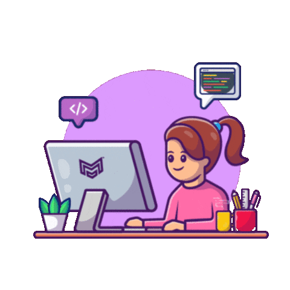

<!-- Banner animado -->

  

<!-- Apresentação -->

<h3 align="center">
  🌸 Welcome to my coding journey! 🌸
</h3>

<!-- Animação de digitação -->

  

<!-- GitHub Statistics -->

  

  

<!-- Seção de tecnologias -->

               

 
<!-- Seção About Me -->

 

<h2>🌸 About Me</h2>

  Hi! I'm Thaís, a technology student passionate about
  learning, creativity, and software development.

  I'm currently exploring programming and building
  my skills through hands-on projects.

  💻 Aspiring Software Developer

  🌱 Currently learning HTML, CSS, JavaScript, and C

  🚀 Exploring new technologies and improving my coding skills

  🎯 My goal is to grow as a developer and create meaningful projects

  ✨ Always curious, always learning!

 

 

<!-- Snake Animation -->

 
